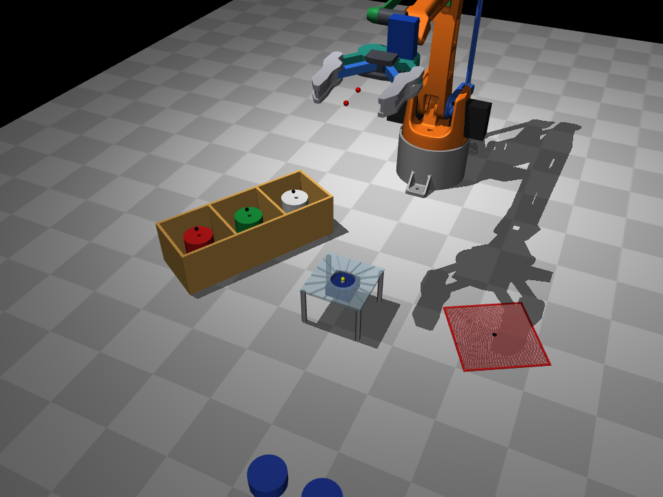
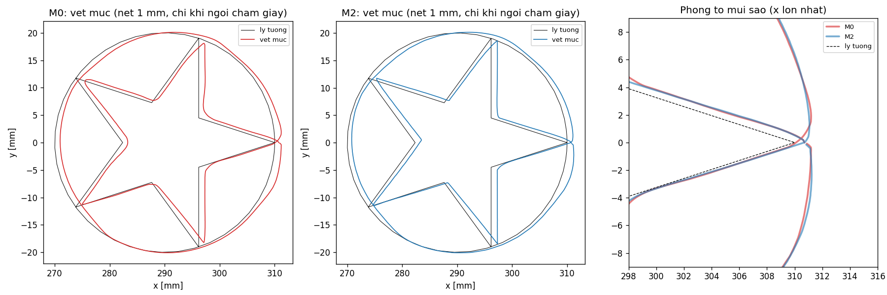

<div align="center">

# EEZYbotARM Mk2 Simulation

**MuJoCo model of a 3-DOF EEZYbotARM Mk2 with closed parallelogram loops, a photo-reconstructed gripper,
a pen-drawing trajectory benchmark (M0 vs M2) and a full bottle-cap colour-sorting cycle.**




</div>

Simulation package for the CE212 course project *"3-DOF robot arm for product sorting"*. It provides closed-form FK/IK with a
servo-angle mapping layer, MuJoCo dynamics of the real arm (13 original STL parts, servo torque saturation, gravity sag),
and two experiments that mirror the hardware tasks: drawing a star + circle with two trajectory methods, and sorting
bottle caps by colour with the same classifier and calibration as the ESP32 firmware
([eezybot_mk2_robot](https://github.com/NithanNguyen/eezybot_mk2_robot)).

> [!NOTE]
> Results come from simulation only and have not yet been validated on the physical arm. Several parameters in `params.py`
> are tagged `[GIA-DINH]` (assumed) and must be calibrated on hardware
> ([calibration-and-limitations.md](assets/docs/calibration-and-limitations.md)). The reference run used Python 3.8.20 on
> Linux x86_64, not on a real Ubuntu 20.04 machine; the viewer was only tested on a virtual display (Xvfb).

## Models

| Model | Content | Used by |
|---|---|---|
| `model/mk2.xml` | Arm + real gripper (SG90, translating fingers, 1:1 gears), no pen | Manual viewing |
| `model/mk2_pen.xml` | Adds a Ø10 pen between the fingers and a 1 mm A4 sheet; ink recorded only on tip–paper contact | `run_sim.py`, `check_kinematics.py --pen` |
| `model/mk2_sort.xml` | Sensor rack with GY-33, 3-compartment bin, reject area, 9 caps; caps gripped by real contact and friction | `run_sort.py` |

All three are prebuilt in `model/`. Rebuilding from STL is only required after editing `params.py`, `gripper.py` or `gripper_shape.py`.

## Results

**Drawing benchmark** — star + circle, R = 20 mm, same duration T = 3.60 s for both methods; metrics measured on the ink trace (mm):

| Method | Mean overshoot | Mean vertex error | Roundness | Max straightness error | Ink coverage |
|---|---|---|---|---|---|
| M0 — linear, constant speed | −0.81 | 0.85 | 1.02 | 1.19 | 100 % |
| M2 — double-S (Ruckig) | −0.44 | 0.50 | 0.55 | 1.17 | 100 % |

> Negative overshoot means the stroke cuts the corner. Metric definitions: [methods.md](assets/docs/methods.md#4-drawing-metrics).



**Colour sorting** — 9 caps (3 red, 3 green, 3 white), seed 0:

| Metric | Value |
|---|---|
| Caps delivered to the correct compartment | 9 / 9 (also 9 / 9 for seeds 1–3; 11 / 11 with 2 foreign objects) |
| Classifier on the firmware test set (`color_sim.py`) | 99 / 100 |
| Cycle time (cap placed → arm back home) | mean 7.35 s (min 7.22, max 7.50) |
| Finger contact with rack / bin / table | 0 command cycles |

> The simulated sensor replays real readings from `data/color/test.csv`; TCS34725 optics are not simulated.
> Details and limitations: [sorting-task.md](assets/docs/sorting-task.md).

## Requirements

| Item | Version |
|---|---|
| OS | Ubuntu 20.04 x86_64 (glibc ≥ 2.28) |
| Python | 3.8 |
| Python packages | `requirements.txt`: mujoco 3.2.3, numpy 1.24.4, matplotlib 3.7.5, ruckig 0.12.2, trimesh 4.4.9, networkx 3.1, scipy 1.10.1 |
| GPU / OpenGL | Only for the viewer and rendered images; headless runs work without it |

> [!WARNING]
> The pins are the last releases with Python 3.8 wheels (e.g. mujoco 3.2.4 requires Python ≥ 3.9). Use Python 3.8 and do not
> upgrade packages individually.

## Quick start

```bash
git clone https://github.com/NithanNguyen/eezybot_mk2_sim.git && cd eezybot_mk2_sim
python3 -m venv ~/venvs/mk2 && source ~/venvs/mk2/bin/activate
pip install -r requirements.txt
python -m mujoco.viewer --mjcf=model/mk2.xml    # drag the sliders in the Control panel
python run_sort.py --view                       # watch the full sorting cycle
```

Full setup with per-step checks and the STL rebuild: [installation.md](assets/docs/installation.md).

## Usage

| Command | Purpose | Output |
|---|---|---|
| `python check_kinematics.py [--pen]` | FK/IK round trip, MuJoCo vs analytic FK, gravity sag, feasible drawing size | `results/workspace_rz_*.png` |
| `python run_sim.py --pen [--view] [--R 15]` | M0 vs M2 drawing experiment | `results/` (plots, CSV logs, ink renders) |
| `python run_sort.py [--view] [--seed N] [--foreign N]` | Colour-sorting cycle | `results/sort/` |
| `python color_sim.py` | Check the classifier against the firmware evaluation | console |
| `python snapshot.py --xyz X Y Z [--pen] [--grip DEG]` | Pose render via IK for reports | `results/*.png` |
| `python build_model.py --stl-dir <STL_DIR>` | Rebuild the three models from the original STL | `model/` |
| `python tools/check_assembly.py --stl-dir <STL_DIR>` | Interpenetration and gripper self-collision check | console |

Expected outputs and pass criteria for each command: [simulation-guide.md](assets/docs/simulation-guide.md) and
[sorting-task.md](assets/docs/sorting-task.md).

## Repository structure

```
eezybot_mk2_sim/
├── params.py              # all parameters (arm, gripper, pen, servos, sorting layout), each with its source
├── mk2_kinematics.py      # closed-form FK/IK, joint and servo limits, servo mapping; set_tool()
├── gripper.py             # real gripper: geometry, finger kinematics, prism meshes, masses
├── gripper_shape.py       # gripper profiles extracted from photos (generated)
├── build_model.py         # STL + gripper -> model/mk2.xml, mk2_pen.xml, mk2_sort.xml
├── sort_scene.py          # sorting-scene objects and colliding finger pads
├── color_sim.py           # copy of the firmware colour classifier + replayed sensor
├── sim_common.py          # model loading, 20 ms command hold, joint readout
├── trajectories.py        # star + circle figure, M0 and M2 trajectories
├── check_kinematics.py    # kinematics verification
├── run_sim.py             # M0 vs M2 drawing experiment
├── run_sort.py            # colour-sorting cycle
├── snapshot.py            # pose renders
├── tools/                 # STL hole measurement, assembly check, sorting-layout check, photo -> profile
├── data/color/            # model.json (calibration) + test.csv, copied from eezybot_mk2_robot
├── model/                 # prebuilt MJCF models and meshes
├── results/               # sample outputs (overwritten by the scripts)
└── assets/
    ├── docs/              # detailed documentation
    ├── images/            # gripper photos, design figures, scene renders
    └── simulation_results/  # reference images for comparison
```

## Documentation

| Document | Content |
|---|---|
| [installation.md](assets/docs/installation.md) | Machine checks, install, STL download, model rebuild, assembly check, verification history |
| [simulation-guide.md](assets/docs/simulation-guide.md) | Viewer, kinematics verification, drawing experiment, snapshots — with expected outputs |
| [sorting-task.md](assets/docs/sorting-task.md) | Sorting scene, layout, cycle, results, task-specific limitations |
| [methods.md](assets/docs/methods.md) | Model construction, kinematics, trajectories, metrics, ESP32 porting |
| [calibration-and-limitations.md](assets/docs/calibration-and-limitations.md) | Parameters to measure on hardware, model limitations |
| [troubleshooting.md](assets/docs/troubleshooting.md) | Common errors and fixes |
| [references.md](assets/docs/references.md) | Full source list |

## Credits and license

- Arm STL: daGHIZmo, *EEZYbotARM Mk2*, [Thingiverse thing:1454048](https://www.thingiverse.com/thing:1454048), licensed **CC BY-NC**. The meshes in `model/meshes/EBAmk2_*` are derived from these files.
- Simulation: [MuJoCo](https://mujoco.readthedocs.io); time-optimal trajectories: [Ruckig](https://github.com/pantor/ruckig) (Berscheid & Kröger, RSS 2021).
- Firmware and colour calibration: [eezybot_mk2_robot](https://github.com/NithanNguyen/eezybot_mk2_robot).

No license file is provided for the code in this repository yet.

Author: [Nithan Nguyen](https://github.com/NithanNguyen)
